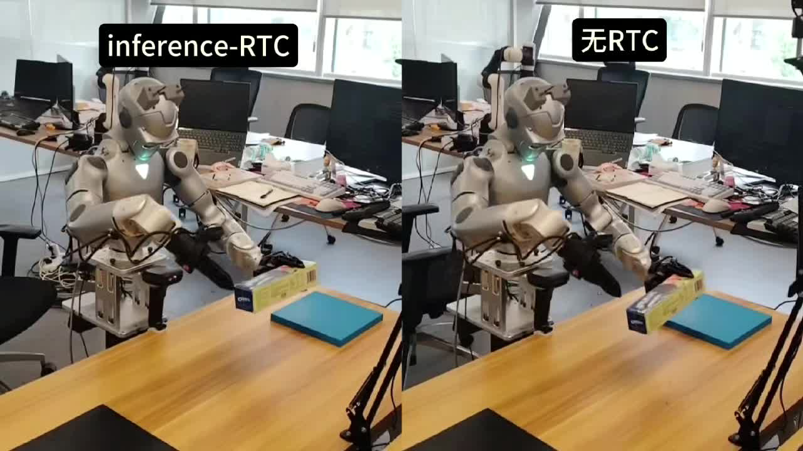
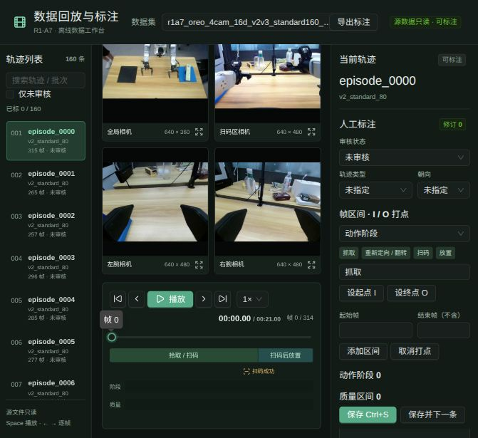

# R1-A7 Autonomous Checkout System

A research prototype for robotic checkout using a Unitree R1-A7 dual-arm robot,
Dex1 grippers, four RGB cameras, and a barcode scanner. The project adapts a
π0.5 policy to product pickup, cooperative reorientation, barcode presentation,
and placement. The full private system also integrates a checkout application;
that application's source is not part of this release.

This repository is a research source snapshot, not a turnkey deployment. Project-owned original code uses Apache-2.0;
imported components retain their own licenses. Trained weights and recorded
datasets are not included. Do not assume multi-product generalization from the
available single-product experiments.

[中文说明](README_zh-CN.md) · [操作手册](使用手册.md) ·
[Architecture](docs/architecture.md) · [Third-party sources](THIRD_PARTY_NOTICES.md)

## Videos

[](docs/videos/rtc-comparison.mp4)

**Left: RTC. Right: non-RTC.** Click the cover to open the video file; download it
if GitHub does not provide inline playback.

[Demo 1](docs/videos/checkout-demo-1.mp4) · [Demo 2](docs/videos/checkout-demo-2.mp4) · [Video context](docs/videos/README.md)

The maintainer confirms original-speed playback with original audio retained.
These clips illustrate motion, not aggregate success rates. Checkpoint and
configuration have not been independently verified for each clip; do not infer
a timing improvement from the file duration alone.

## What is included

- PICO controller teleoperation adapted for R1-A7 and Dex1, with a 16-dimensional
  policy interface: 14 arm-joint targets and two gripper targets.
- Four-camera collection and a visual console for camera feeds, barcode events,
  and collection progress; dataset playback, review, annotation, and interval export.
- Conversion from the Unitree recorder format to LeRobot v3, task segmentation,
  dataset checks, and normalization-statistics preparation.
- π0.5 training and guarded inference entry points, plus PICO expert takeover
  and reviewed intervention-data export for iterative training.
- An isolated guided RTC inference path with asynchronous action generation,
  previous-plan guidance, and experiment-log comparison tools.
- Scanner-event interfaces. Barcode acceptance is an
  external event: it triggers the scan-to-placement task transition rather than
  being inferred from camera images alone.

## Tool screenshots

Four-camera dataset playback and annotation. Top row: global/scanner; bottom row:
left/right wrist. Images are recorded data, not live camera feeds.



[Scan-event frame](docs/images/dataset-review.jpg) · [Collection console, offline](docs/images/collection-console-offline.jpg) · [Screenshot context](docs/images/README.md)

The collection screenshot shows actual completed-batch progress and historical
logs. Live camera services were offline during capture; no live-feed claim is made.

## Workflow and entry points

| Workflow | Documentation | Entry point |
| --- | --- | --- |
| Teleoperation and collection | [Operation manual](使用手册.md) | `scripts/start-teleop.sh` |
| Collection dashboard | [Console](apps/r1-collection-console/README.md) | `scripts/start-collection-console.sh` |
| Playback and annotation | [Dataset review](apps/r1-dataset-review/README.md) | `scripts/start-dataset-review.sh` |
| Dataset preparation and training | [Training/deployment](docs/r1a7-lerobot-pi05.md) | `scripts/lerobot/` |
| Expert takeover | [DAgger collection](docs/r1a7-dagger-接管采集.md) | `scripts/lerobot/run-r1a7-pi05-dagger.sh` |
| Guided RTC | [RTC design](docs/r1a7-rtc-spec.md) | `scripts/lerobot/run-r1a7-pi05-rtc-real.sh` |

See the [system architecture](docs/architecture.md) for the data/training/deployment
loop. Teleoperation maps end-effector poses through IK; policy inference outputs
joint/gripper targets directly. Scanner acceptance is an external event, not an
additional numeric policy input. Annotation labels do not enable high-level
subtask-text generation.

## Layout

```text
apps/r1-collection-console  Collection monitoring console
apps/r1-dataset-review      Playback, review, and annotation tools
robot/xr-teleoperate        Teleoperation and hardware interfaces
robot/dex1-service          Dex1 serial/DDS service
data/unitree-lerobot        Dataset conversion, training, and policy inference
vendor/                    Imported Unitree SDK sources and libraries
scripts/                   Workflow entry points
config/collection/         Example collection plans
docs/                      Architecture and workflow documentation
runtime/                   Local-only datasets, weights, logs, and environments
```

The upstream sources are vendored, not Git submodules. Their origins and pinned
import revisions are recorded in `versions.lock`; project changes are included
in this source snapshot. Preserve each component's license and attribution.

## Before running

**Known limitation:** the barcode bridge still imports a HID scanner reader
from the excluded private checkout application and expects its SQLite product
catalog schema. An independent public scanner reader and catalog initialization
path are required before the complete scanner-driven workflow can run. Do not
interpret the current source snapshot as a runnable end-to-end checkout release.

Start with the Chinese operation manual and component READMEs. This is a hardware-
specific research system, not a one-command simulator or a turnkey deployment.

Robot mesh files and precompiled libraries are deliberately excluded from this
source release pending separate redistribution review. Obtain the matching files
from the official component repositories at the revisions in `versions.lock`,
subject to their applicable licenses, before building or running hardware tools.
See `PUBLIC_RELEASE_CHECKLIST.md` for validation boundaries.

1. Install the Python/Node environments required by the chosen component. The
   existing bootstrap script also requires `git-lfs`.
2. Replace example paths, network interfaces, camera identifiers, scanner devices,
   and network addresses with your own configuration.
3. Keep local service secrets in ignored configuration, never in tracked templates.
4. Supply your own compatible checkpoint, tokenizer, and dataset metadata/statistics.
   The policy and its processors must match the four-camera/16D contract.
5. Run offline or read-only validation before attempting real-hardware execution.

`/home/user`, `/data/project`, `192.168.1.100`, and `YOUR_ACCOUNT` are examples,
not credentials or working deployment endpoints. R1-specific DDS addresses in
`192.168.123.0/24` have been retained because the robot interface depends on them.
Some scripts still contain experiment-specific checkpoint defaults; override
these explicitly rather than assuming that model files are bundled.

## Hardware safety

Real-robot entry points can move the arms, grippers, and initial pose. A start-pose
return is itself motion, even before policy execution. Use an emergency stop,
keep the workspace clear, and confirm device ownership and safety limits.

Do not start multiple hardware command publishers. Do not expose control or
scanner-event endpoints directly to the Internet. A safety-confirmation flag is
not a substitute for a physical safety procedure.

## Results and limitations

The project has been used for real-robot checkout demonstrations. Test outcomes
depend on product placement, grasp geometry, model version, and execution settings.
It does not establish general checkout capability across unseen products or
certify safe unattended operation. Dataset counts and checkpoint names in the
workflow documents describe particular experiments, not bundled release assets.

## Attribution and release status

This work builds on Unitree teleoperation/SDK components and Hugging Face LeRobot.
Project work includes integration, collection/review tools, workflow adaptations,
and RTC deployment experiments; it is not a new foundation model implementation.
The checkout application and its dedicated launcher are excluded. Collection
monitoring and dataset review tools remain included; these are separate from the
private checkout application. Some workflow documents describe the full private
system and mention excluded components; those sections are contextual references,
not instructions for a bundled checkout application.

See [the release checklist](PUBLIC_RELEASE_CHECKLIST.md) for release scope and limitations.
Project-owned original code is licensed under [Apache-2.0](LICENSE). See
[license scope](LICENSE_SCOPE.md) for the component boundaries. Existing third-party
licenses remain alongside their respective components and are not replaced by
the root license.
