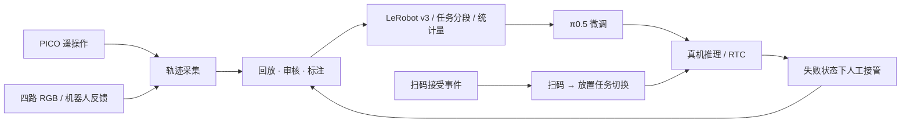

# 基于 π0.5 的 R1-A7 双臂机器人收银系统

[English](README.md) · [系统架构](docs/architecture.md) · [使用手册](使用手册.md) · [发布范围](PUBLIC_RELEASE_CHECKLIST.md)

使用宇树 R1-A7 双臂、Dex1 夹爪、PICO 手柄和四路 RGB 相机，完成商品抓取、协同翻转、扫码及放置。围绕 π0.5 建立遥操作数采、数据审核、模型微调、真机推理和人工纠正再训练流程，并提供独立 RTC 推理入口。

完整私有系统还联动结账上位机完成商品查询与入单；该上位机由队友开发，不在本仓库中发布。

> 这是研究代码快照，不是开箱即用的完整收银产品。扫码桥依赖未公开的 HID 模块及数据库结构；机器人网格和预编译库未包含，需要从官方组件获取。模型、项目采集数据和个人资料不随仓库发布。

## 演示视频

[](docs/videos/rtc-comparison.mp4)

**左侧 RTC，右侧无 RTC。** 点击封面查看视频文件；GitHub 若不直接播放，可下载观看。

[演示视频 1](docs/videos/checkout-demo-1.mp4) · [演示视频 2](docs/videos/checkout-demo-2.mp4) · [视频说明](docs/videos/README.md)

视频为原速播放、保留原声（维护者确认），用于展示动作过程，不替代多次受控测试。各段模型版本和参数尚未逐段核对，不从文件时长直接计算 RTC 收益。

## 核心功能

| 模块 | 功能 | 文档与入口 |
| --- | --- | --- |
| 遥操与数采 | PICO 控制、四路图像、16 维接口，批次续采与重录 | [使用手册](使用手册.md)、`scripts/start-teleop.sh` |
| 数采监控 | 四路实时画面、扫码事件与采集进度 | [监控台说明](apps/r1-collection-console/README.md)、`scripts/start-collection-console.sh` |
| 回放与审核 | 四路同步回放、区间标注、无效片段过滤及导出 | [回放工具说明](apps/r1-dataset-review/README.md)、`scripts/start-dataset-review.sh` |
| 数据与训练 | LeRobot v3 转换、任务分段、统计量重算、π0.5 微调 | [训练部署说明](docs/r1a7-lerobot-pi05.md) |
| 人工纠正 | 自主推理中 PICO 接管，专家恢复轨迹审核与导出 | [接管采集](docs/r1a7-dagger-接管采集.md)、[审核导出](docs/r1a7-dagger-reviewed-training-export.md) |
| RTC | 异步动作块生成、前缀引导、延迟补偿与日志对比 | [RTC 设计](docs/r1a7-rtc-spec.md)、`scripts/lerobot/run-r1a7-pi05-rtc-real.sh` |

## 工具界面

四路数据回放与标注，上排全局/扫码区，下排左腕/右腕。截图来自已录轨迹，不是实时相机流。


[扫码关键帧](docs/images/dataset-review.jpg) · [监控台离线批次界面](docs/images/collection-console-offline.jpg) · [截图来源与状态](docs/images/README.md)

监控台截图显示已完成批次的进度及历史日志；当前实时相机服务未运行，画面保留等待视频流状态。

## 系统链路



策略接口为双臂 14 维关节目标加 2 维夹爪目标。遥操的末端位姿经过 IK 转为关节目标；π0.5 直接输出关节与夹爪目标，不再经过末端 IK。

扫码成功由扫码器事件确认，不让模型仅凭图像猜测。自定义阶段标签用于数据分析，不代表本项目已实现高层子任务文本预测。

## 代码边界

项目基于宇树遥操、SDK 和 LeRobot 实现，重点是收银场景集成、数采与回放工具、任务事件接口、数据流程、真机部署和 RTC 适配，而不是重新实现基础模型或机器人 SDK。上游来源见 [`versions.lock`](versions.lock)，第三方组件保留各自许可与署名。

```text
apps/r1-collection-console   数采监控
apps/r1-dataset-review       回放、审核与标注
robot/xr-teleoperate         遥操作、图像与机器人控制
robot/dex1-service           夹爪串口/DDS 服务
data/unitree-lerobot         数据、训练与推理
vendor/                     上游 SDK 源码
scripts/                    工作流入口
config/collection/          示例采集计划
docs/                       设计与操作说明
runtime/                    本地数据、模型和日志（Git 忽略）
```

## 开始使用

先阅读对应模块文档，不要直接执行真机命令。仓库没有 Git 子模块；`versions.lock` 记录来源，不会自动下载依赖或恢复被排除的资源。

安装 Git LFS 后，可克隆并检查仓库结构：

```bash
git clone https://github.com/IDK-U-Yet/r1-a7-autonomous-checkout.git
cd r1-a7-autonomous-checkout
bash scripts/check.sh
```

该检查不安装环境、不移动机器人，也不能证明硬件链路正常。上游测试夹具使用 Git LFS；机器人网格和预编译库需另行获取。

运行前需要按模块安装 Python/Node 环境，配置网卡、相机、扫码设备及文件路径，并提供兼容四路相机与 16 维接口的 checkpoint、处理器及归一化统计量。先做离线或只读检查，再由操作者确认真机安全条件。

**真机入口会移动机械臂和夹爪，回初始姿态也是运动。** 保持急停可用，不同时启动多个硬件指令发布进程，不将控制端口暴露到互联网。

## 已有实践与限制

系统已用于真机收银演示、纠正数据再训练和有无 RTC 对比。抓偏及双臂衔接仍是主要失败点，不能据此宣称对未见商品具有稳定泛化能力，也不保证无人值守安全。

公开快照做过源码语法与部分单元测试，未完成新机器完整安装或整套硬件验证。历史文档保留实验配置和私有系统说明，不代表相关数据、模型或组件已提供。完整限制见 [发布范围](PUBLIC_RELEASE_CHECKLIST.md)。

## 许可证

项目自有原创代码采用 [Apache-2.0](LICENSE)。第三方源码沿用各自许可证，根许可证不覆盖上游许可，也不授权未包含的上位机、模型与数据。详见 [许可范围](LICENSE_SCOPE.md) 和 [第三方来源](THIRD_PARTY_NOTICES.md)。
