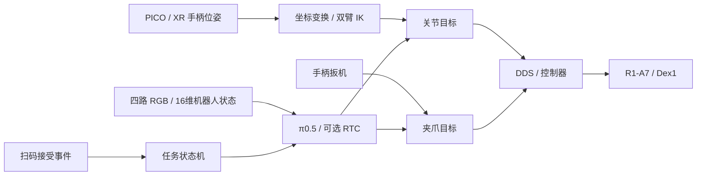

# 系统与仓库架构

`r1-a7-autonomous-checkout` 是机器人工作流的公开源码快照，不保存运行数据。包含数采监控、数据回放审核、遥操作、夹爪服务、数据转换和固定版本的厂商 SDK 源码。结账上位机、机器人网格及预编译库不公开分发。本副本没有复制私有仓库的提交历史。

## 工作流与控制链路



- 遥操输入是末端目标位姿；策略输出是关节和夹爪目标，二者不要混淆。
- 扫码事件切换 scan/place 任务；结账业务系统不属于模型内部模块。
- 原始轨迹经回放审核、任务分段和格式转换用于训练；人工接管轨迹经审核后聚合回训练数据。
- 数采监控和回放工具不发布机器人运动指令。完整运行仍受下文私有扫码依赖及未分发资源限制。

## 源码布局

```text
r1-a7-autonomous-checkout
├── apps/r1-collection-console
├── apps/r1-dataset-review
├── robot/xr-teleoperate
│   └── teleop
│       ├── teleimager
│       ├── televuer
│       └── robot_control/dex-retargeting
├── robot/dex1-service
├── data/unitree-lerobot
│   └── unitree_lerobot/lerobot
├── vendor/unitree-sdk2
└── vendor/unitree-sdk2-python
```

上述目录都是普通源码目录，不包含嵌套 Git 仓库，也不依赖 `.gitmodules`。`versions.lock` 保存外部源码导入时的仓库地址和基准提交，便于审计来源，但不会自动拉取上游代码。

外部组件更新采用受控导入流程：在独立分支获取指定上游版本，比较并合入所需文件，运行对应组件和系统级测试，更新 `versions.lock`，最后以一个主仓库提交固定整个系统版本。不要直接用上游工作树覆盖包含本地修改的目录。

所有入口程序通过脚本位置或 `R1A7_ROOT` 推导依赖路径。`UNITREE_SDK2_PYTHON_PATH` 可在组件脱离集成仓库单独运行时覆盖 Python SDK 路径。

独立扫码桥的事件发送和商品查询代码已包含，但启动时仍导入被排除的上位机 HID 模块。公开版需要独立的扫码读取实现及商品目录初始化方式，当前不应视为可完整运行的端到端发布版。
